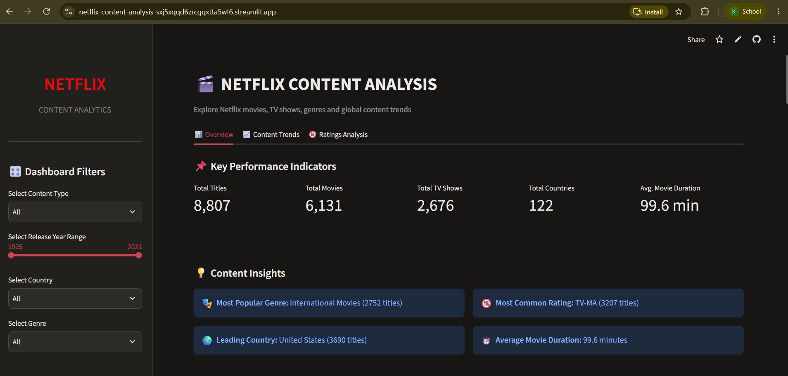
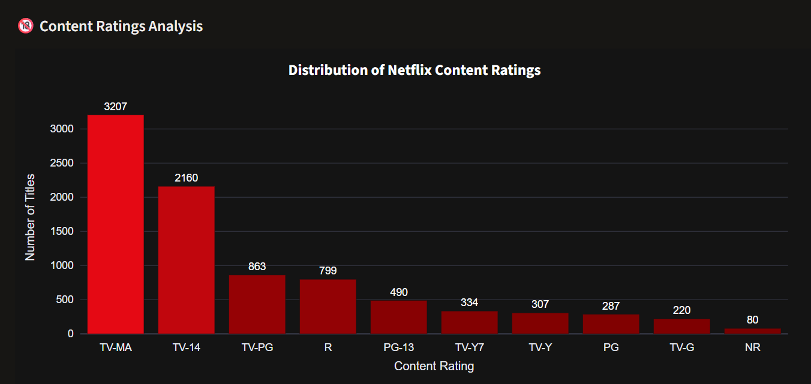
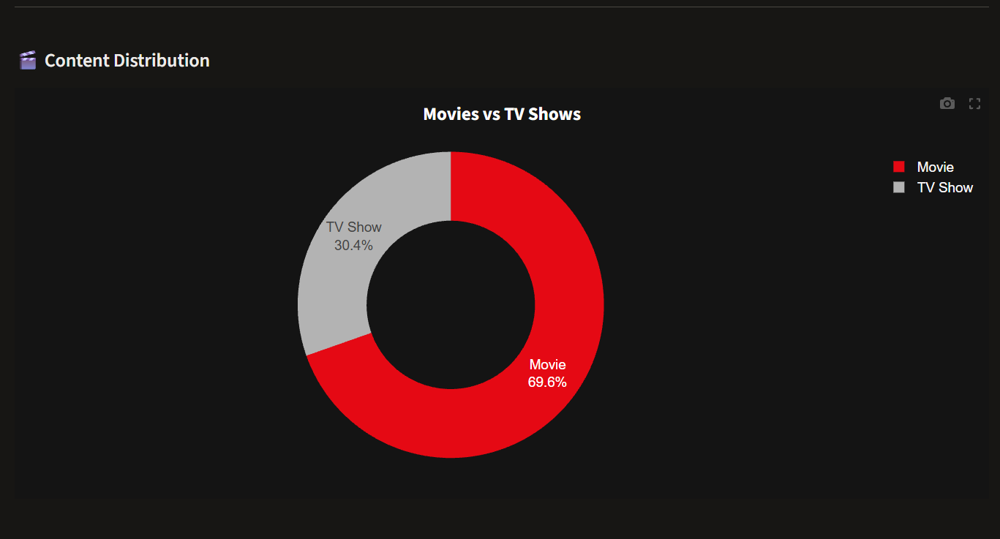
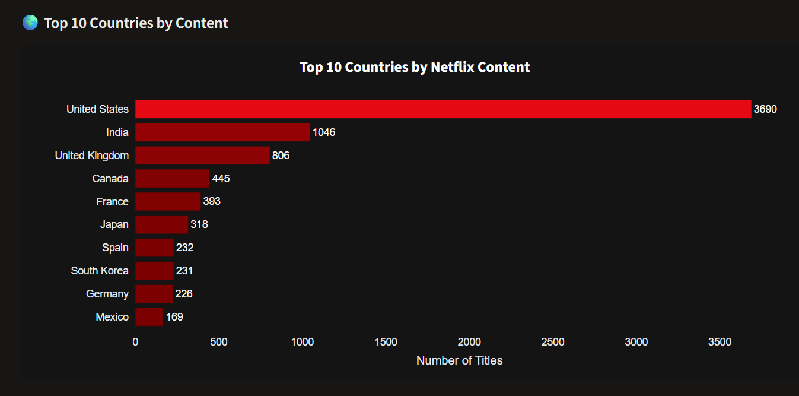
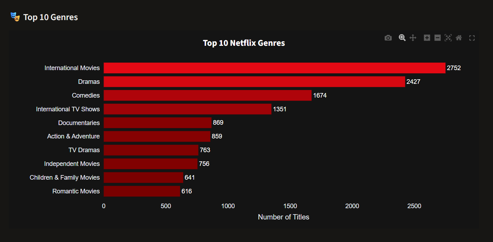
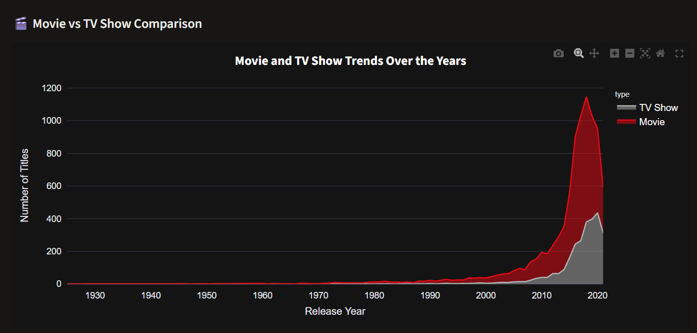
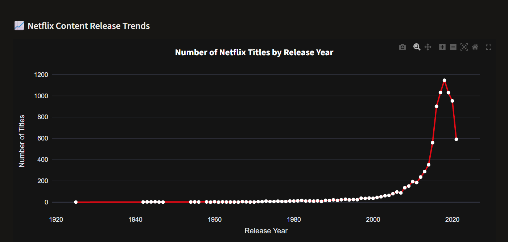
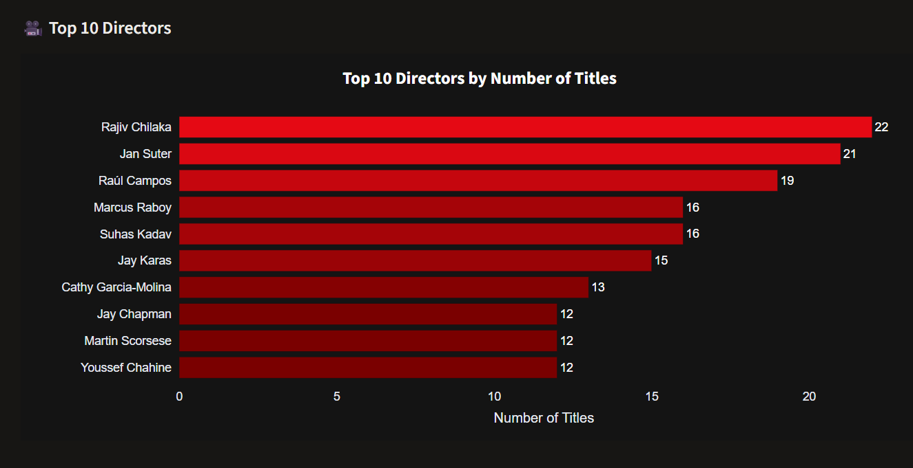

# 🎬 Netflix Content Analysis | Interactive Analytics Dashboard

An end-to-end Data Analytics project that explores the Netflix Movies and TV Shows dataset to uncover insights into content distribution, genres, countries, ratings, directors, and release trends using **Python, SQL, Streamlit, and Plotly**.

## 🚀 Live Dashboard

Explore the interactive Netflix Content Analysis Dashboard:

👉 [**Click here to view the Live Dashboard**](https://netflix-content-analysis-sxj5xqqd6zrcgqxtta5wf6.streamlit.app/)

## 📌 Project Overview

This project focuses on analyzing the Netflix Movies and TV Shows dataset to understand its content catalogue through data cleaning, exploratory data analysis, SQL queries, and interactive visualizations.

The project transforms raw Netflix data into meaningful insights through an interactive Streamlit dashboard.

## 🎯 Project Objectives

- Analyze the distribution of Movies and TV Shows.
- Identify countries contributing the most content.
- Explore popular genres and content categories.
- Understand content release trends over the years.
- Analyze content ratings and audience classifications.
- Identify directors with the highest number of titles.
- Build an interactive dashboard for data exploration.

## 🛠️ Tech Stack

| Technology | Purpose |
|---|---|
| Python | Data analysis and processing |
| Pandas | Data cleaning and manipulation |
| SQL Server | Database management and SQL analysis |
| Streamlit | Interactive dashboard development |
| Plotly | Interactive data visualization |
| Matplotlib | Static visualizations |
| VS Code | Development environment |
| Git & GitHub | Version control and project hosting |

## 📂 Dataset

**Dataset:** Netflix Movies and TV Shows

**Source:** Kaggle

[View Dataset on Kaggle](https://www.kaggle.com/datasets/shivamb/netflix-shows)

- Total Records: 8,807
- Total Columns: 12
- Content Types: Movies and TV Shows

The dataset contains information about titles, directors, cast, countries, release years, ratings, durations, and genres.

## 🔄 Project Workflow

1. **Data Collection:** Imported the Netflix dataset from Kaggle.
2. **Data Cleaning:** Handled missing values, checked duplicates, and transformed date columns.
3. **Exploratory Data Analysis:** Examined content distribution, genres, countries, ratings, and release trends.
4. **SQL Analysis:** Used SQL queries to extract meaningful insights.
5. **Data Visualization:** Created charts to understand important patterns and trends.
6. **Dashboard Development:** Built an interactive dashboard using Streamlit and Plotly.
7. **Deployment:** Deployed the dashboard using Streamlit Community Cloud.

## 📊 Dashboard Features

The dashboard provides interactive visualizations and analytical insights through three main sections.

### 1. Overview

- Total Titles
- Total Movies
- Total TV Shows
- Total Countries
- Average Movie Duration
- Movies vs TV Shows Distribution
- Top 10 Countries by Content
- Top 10 Popular Genres
- Movie vs TV Show Trends
- Top 10 Directors

### 2. Content Trends

- Release-year analysis
- Year-wise content distribution
- Interactive content trend visualization

### 3. Ratings Analysis

- Distribution of Netflix content ratings
- Comparison of audience classifications
- Identification of the most common content ratings

### 🎛️ Interactive Filters

The dashboard includes dynamic sidebar filters:

- Content Type
- Release Year Range
- Country
- Genre

The relevant KPIs, charts, and insights update based on the selected filters.

### 💡 Automated Content Insights

The dashboard highlights:

- Most Popular Genre
- Leading Country
- Most Common Rating
- Average Movie Duration

## 🖥️ Dashboard Preview

### 1. Dashboard Overview



### 2. Content Distribution – Movies vs TV Shows



### 3. Movies vs TV Shows Donut Chart



### 4. Top 10 Countries by Content



### 5. Top 10 Netflix Genres



### 6. Movie and TV Show Trends



### 7. Release Trends



### 8. Top 10 Directors



👉 [**Explore the Live Interactive Dashboard**](https://netflix-content-analysis-sxj5xqqd6zrcgqxtta5wf6.streamlit.app/)

## 📁 Project Structure

```text
Netfix_Content_Analysis/
│
├── data/
│   ├── netflix_titles.csv
│   └── netflix_cleaned.csv
│
├── screenshots/
│   ├── dashboard_overview.png
│   ├── content_distribution.png
│   ├── donut.png
│   ├── release_trends.png
│   ├── content_trends.png
│   ├── top_countries.png
│   ├── top_directors.png
│   └── top_genres.png
│
├── visualizations/
│   ├── content_distribution.png
│   ├── top_countries.png
│   └── top_genres.png
│
├── app.py
├── netflix_analysis.py
├── netflix_analysis.sql
├── requirements.txt
├── README.md
└── .gitignore
```

## ⚙️ Installation and Execution

### Step 1: Clone the Repository

```bash
git clone https://github.com/krushitha737/Netflix-Content-Analysis.git
```

### Step 2: Navigate to the Project Folder

```bash
cd Netflix-Content-Analysis
```

### Step 3: Install Required Libraries

```bash
pip install -r requirements.txt
```

### Step 4: Run the Streamlit Dashboard

```bash
python -m streamlit run app.py
```

The dashboard will open in your default web browser.

## 📈 Key Analytical Findings

- The dataset contains 8,807 Netflix titles.
- Movies represent a larger portion of the catalogue than TV Shows.
- The United States contributes the highest number of titles.
- International Movies, Dramas, and Comedies are among the most common genres.
- TV-MA is the most frequently occurring content rating.
- The dataset shows notable growth in content releases during the later years represented.

## 🧠 Skills Demonstrated

- Data Cleaning and Preprocessing
- Exploratory Data Analysis (EDA)
- Data Manipulation using Pandas
- SQL Querying and Data Analysis
- Data Visualization
- Interactive Dashboard Development
- Analytical Thinking
- Data Storytelling
- Dashboard Deployment

## 🔮 Future Enhancements

- Add advanced genre-based analysis.
- Include year-wise country comparisons.
- Implement additional interactive visualizations.
- Expand the dashboard with more analytical insights.

## 👩‍💻 Author

**Krushitha**  
B.Tech – Computer Science and Engineering

- GitHub: [krushitha737](https://github.com/krushitha737)
- Project Repository: [Netflix Content Analysis](https://github.com/krushitha737/Netflix-Content-Analysis)
- Live Dashboard: [Streamlit App](https://netflix-content-analysis-sxj5xqqd6zrcgqxtta5wf6.streamlit.app/)

---

⭐ If you find this project useful, consider giving it a star!